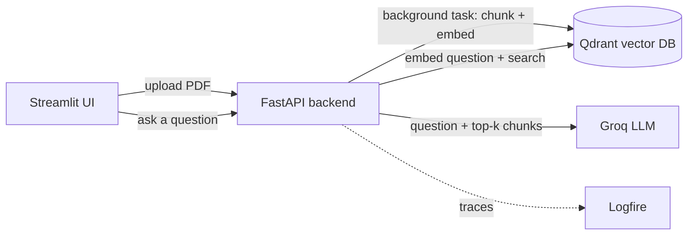

# RAG PDF Q&A

Ask questions about your PDFs and get answers grounded in the document, with sources. Built with **FastAPI**, **Qdrant**, **Groq** and **Logfire**, plus an **evaluation harness** that scores every change to the prompt, model or retrieval settings.

  

## Features

- **Upload and ingest PDFs** in the background, with live status in the UI
- **Grounded answers** from retrieved chunks only, with source file names
- **Safe fallback**: replies "I couldn't find that in the uploaded documents" instead of guessing
- **Free to run**: embeddings run locally (no embedding API key); Groq's free tier handles the LLM
- **Observability**: every step (search, LLM call, retries) is traced in Logfire with timings, token counts and retrieval scores
- **Evaluation**: `eval.py` measures retrieval quality, answer correctness, refusal behaviour and latency, and compares each run with the last
- **One-click reset** to clear all stored documents and start fresh

## Working (Screenshots)


https://github.com/user-attachments/assets/1ea19754-77f4-4e0e-b8c4-260e33643e8c


## Architecture



**Ingest:** the PDF is split into overlapping chunks, each chunk is embedded locally with `BAAI/bge-small-en-v1.5`, and the vectors are stored in Qdrant.
**Query:** the question is embedded, the closest chunks are retrieved, and the LLM answers using only those chunks.

## Tech stack

| Part | Tool |
|---|---|
| API | FastAPI (+ `BackgroundTasks` for ingestion) |
| UI | Streamlit |
| Vector database | Qdrant (cosine similarity, 384 dimensions) |
| Embeddings | `sentence-transformers` with `BAAI/bge-small-en-v1.5`, run locally |
| PDF loading and chunking | LlamaIndex (`PDFReader`, `SentenceSplitter`) |
| LLM | Groq via its OpenAI-compatible API (default `openai/gpt-oss-120b`) |
| Observability | Pydantic Logfire |

## Quick start

**Prerequisites:** Python 3.10+, Docker, and a free [Groq API key](https://console.groq.com).

```bash
# 1. Clone and enter the project
git clone https://github.com/<your-username>/<repo-name>.git
cd <repo-name>

# 2. Create a virtual environment and install dependencies
python -m venv venv
venv\Scripts\activate          # Windows   (macOS/Linux: source venv/bin/activate)
pip install -r requirements.txt

# 3. Add your settings
copy .env.example .env         # macOS/Linux: cp .env.example .env
# then open .env and set GROQ_API_KEY

# 4. Start Qdrant
docker compose up -d

# 5. Start the backend (terminal 1)
uvicorn main:app --reload

# 6. Start the UI (terminal 2, with the venv activated)
streamlit run streamlit_app.py
```

Open http://localhost:8501, upload a PDF, wait for "Ingested N chunks", then ask a question.

**Logfire (optional):** run `logfire auth` and `logfire projects new` to send traces to your dashboard. Without it, the app still works and prints traces in the terminal.

## API

| Method | Endpoint | Purpose |
|---|---|---|
| POST | `/api/ingest` | Start a background ingestion job, returns a `run_id` |
| GET | `/api/runs/{run_id}` | Check job status (Queued, Running, Completed, Failed) |
| POST | `/api/query` | Answer a question: `{ "question": "...", "top_k": 10 }` |
| POST | `/api/clear` | Delete all stored documents |

Interactive docs are available at http://127.0.0.1:8000/docs.

## Evaluation

`eval.py` sends a fixed set of questions to the running backend and reports:

| Metric | What it tells you |
|---|---|
| `context_recall` | Did the retrieved chunks contain the expected facts? |
| `mrr` | How high did the first useful chunk rank (1.0 = always first)? |
| `answer_pass_rate` | Did answers contain the expected facts? |
| `false_refusal_rate` | How often did it wrongly say "I couldn't find that"? |
| `correct_refusal_rate` | Did it refuse questions the document can't answer, including prompt-injection attempts? |
| `faithfulness`, `correctness` | Optional LLM-as-judge scores (`--judge`) |
| `latency_avg_s`, `latency_p95_s` | Typical and worst-case response time |

```bash
python eval.py                 # keyword checks, 10 questions
python eval.py --judge         # also grade answers with an LLM
python eval.py --top-k 5 --fail-under 0.8
```

Results are saved to `eval_results/` and compared with the previous run, so every prompt, model or chunking change gets a before-and-after number. The script exits with code 1 if the pass rate falls below `--fail-under`, so it can gate a CI pipeline.

The sample dataset `eval_set_sapiens.json` is written for *Sapiens* by Yuval Noah Harari. The book is copyrighted and **not included**; ingest your own copy to reproduce the results, or write a new dataset in the same format for your own documents.

**First baseline** (`top_k=10`, Groq free tier): overall pass rate 0.80, context recall 0.79, MRR 0.46, false-refusal rate 0.00, correct-refusal rate 0.67.

## Project structure

```
.
├── main.py                 # FastAPI app: ingest, query, clear, tracing
├── streamlit_app.py        # Streamlit UI
├── data_loader.py          # PDF loading, chunking, local embeddings
├── vector_db.py            # Qdrant wrapper (upsert, search, clear)
├── eval.py                 # Evaluation harness
├── eval_set_sapiens.json   # Evaluation questions and expected facts
├── docker-compose.yml      # Qdrant
├── requirements.txt
└── .env.example
```

## Design decisions

- **FastAPI background tasks instead of a workflow engine.** The project started on Inngest. For a single-machine app, `BackgroundTasks` plus a small `step()` helper (named spans with retries) gives the same step-by-step visibility in Logfire with far less infrastructure.
- **Local embeddings.** No embedding API key, no per-call cost, and the same model is used for ingestion and search.
- **Strict grounding with a fixed fallback sentence.** A fixed sentence is easy to detect in traces and tests, which is what makes refusal behaviour measurable.
- **Evaluation first.** Changes are judged by numbers from `eval.py`, not by trying a few questions by hand.

## Limitations and roadmap

- Ingestion jobs run inside the server process and are lost if it restarts; run status is kept in memory
- No authentication, and all users share one document collection (`/api/clear` wipes everything)
- Scanned or image-only PDFs have no extractable text (no OCR)
- Planned: retrieval-score threshold to skip the LLM on clearly unrelated questions, per-document filtering, reranking, auth, and running `eval.py` in CI

## License

MIT, see [LICENSE](LICENSE).
